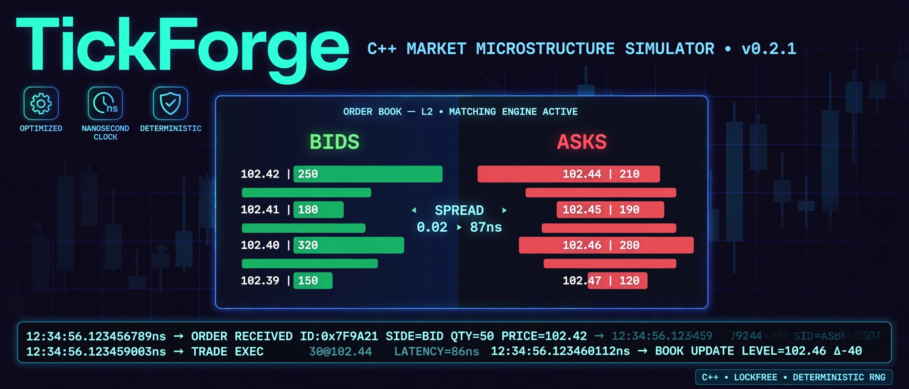

# TickForge

Deterministic market-event replay and matching engine in C++20.



[](https://github.com/SachuJames/tickforge/actions/workflows/ci.yml)
[](LICENSE)


TickForge replays a stream of order events (new, modify, cancel) through a
market-by-order book with price-time priority matching. The same input always
produces the same fills, the same final book, and the same statistics, on any
machine: prices and quantities are integers (ticks and lots), event ordering
is explicit, and nothing in the core reads a clock or an unseeded random
source.

It is a research and verification tool, not a trading system. There is no
exchange connectivity, no live feed, no networking, and no order routing.

## What it does

- Parses one documented CSV event format into normalized events, with
  one-based line diagnostics for malformed records.
- Maintains a market-by-order book: every order is tracked individually,
  with price-time priority, partial fills, and cancel/replace modify
  semantics.
- Replays events in strict mode (first invalid event fails the replay) or
  lenient mode (invalid events are skipped and counted). CSV parse errors
  are never skipped.
- Reports execution statistics (fill count, total/buy/sell quantity,
  min/max price, and an exact integer VWAP kept as a 128-bit numerator
  over the traded quantity), queue position for a designated order, and
  derived market-state views (best bid/ask, per-level aggregates).
- Runs sessions under an explicit configuration (instrument, tick size,
  lot size, matching rule, replay mode, optional PRNG seed) that is
  serialized canonically and identified by a deterministic hash, printed
  with every successful replay.
- Ships a CLI that replays a CSV file and prints a fixed summary.

Correctness is checked against an independent, scan-based reference model:
a generated 6,000-event session is compared event by event (every fill
field, the resting book, best bid/ask) as part of the test suite, along
with deterministic property tests and boundary tests at the int64 limits.

## Build

Requirements: CMake 3.22 or newer, a C++20 compiler (GCC 11+ or Clang 14+),
and Git. Building the tests fetches GoogleTest with CMake FetchContent on
first configure, so the first configure needs network access. The library
and the CLI have no third-party dependencies.

```bash
git clone https://github.com/SachuJames/tickforge.git
cd tickforge
cmake --preset default
cmake --build --preset default -j4
```

This produces `build/tickforge` (the CLI) and `build/tickforge_tests`.

Other presets: `release` (optimized build in `build-release/`) and `asan`
(Debug with AddressSanitizer and UndefinedBehaviorSanitizer in
`build-asan/`).

To install just the CLI executable (headers and libraries are not
installed; there is no stable library installation contract yet):

```bash
cmake --install build-release --prefix /usr/local
```

## Quick start

The repository includes a five-event example session in
`examples/sample_session.csv`: an ask rests, a smaller bid rests, a second
bid crosses the ask for a partial fill, the ask is reduced, and the first
bid is cancelled.

```bash
./build/tickforge --input examples/sample_session.csv --instrument AAPL
```

Output:

```text
TickForge v0.1.0
Input: examples/sample_session.csv
Instrument: AAPL
Replay mode: strict
Events processed: 5
Events skipped: 0
Fills: 1
Resting orders: 1
Best bid: none
Best ask: 105
Config hash: 5dddb109ead805bc
Replay status: success
```

One order is left resting (the ask at 105, reduced to 4 lots), so there is
no best bid. The config hash identifies the exact session configuration
that produced this run; the same command on any machine prints the same
summary.

## CLI reference

```text
tickforge --input PATH --instrument SYMBOL [--mode strict|lenient]
                   [--tick-size VALUE] [--lot-size VALUE] [--seed VALUE]
tickforge --help
tickforge --version
```

| Option | Required | Value |
|---|---|---|
| `--input PATH` | yes | CSV event file to replay. |
| `--instrument SYMBOL` | yes | Session instrument, e.g. `AAPL`. Non-empty, no `=`, newline, or carriage return. |
| `--mode` | no | `strict` (default) or `lenient`. |
| `--tick-size VALUE` | no | Tick size as a decimal string, e.g. `0.01`. Validated by the session configuration rules. |
| `--lot-size VALUE` | no | Lot size as a decimal string, e.g. `1`. Validated the same way. |
| `--seed VALUE` | no | PRNG seed, an unsigned 64-bit decimal integer (`0` to `18446744073709551615`). Stored in the session configuration and covered by its hash. No production component consumes randomness yet. |
| `--help`, `--version` | no | Print usage or the version and exit 0. Invalid arguments are still errors when combined with these. |

Every option may appear at most once. A successful replay prints the
12-line summary to stdout and nothing to stderr. Failures print one
diagnostic to stderr and no summary.

Exit codes:

| Code | Meaning |
|---|---|
| 0 | Success, `--help`, or `--version`. |
| 2 | Invalid arguments: unknown or duplicate option, missing or empty value, missing required option, malformed seed. |
| 3 | The input file could not be opened, or reading it failed. |
| 4 | CSV parsing failed; the diagnostic names the category and the one-based line. |
| 5 | Invalid session configuration, or the replay itself failed (in strict mode the diagnostic names the error and the event position). |
| 6 | An unexpected internal exception. |

## Input format

The first line must be exactly this header (surrounding spaces, tabs, and a
trailing carriage return are trimmed per field):

```text
timestamp,event_type,order_id,side,price,quantity
```

Each record has six fields:

- `timestamp`: event time in nanoseconds, a non-negative integer.
- `event_type`: `N` (new order), `M` (modify), `C` (cancel).
- `order_id`: positive integer identifying the order.
- `side`: `B` (bid) or `A` (ask).
- `price`: price in ticks. Required for new orders; empty on a modify
  means unchanged, empty on a cancel means unused.
- `quantity`: quantity in lots. Required for new orders; on a modify, `0`
  or empty means unchanged. Reducing the quantity keeps queue priority;
  changing the price or increasing the quantity is a cancel/replace and
  the order rejoins at the back of its new level.

Timestamps must strictly increase across the file. A record that breaks
the format stops parsing with an error; there is no partial-success parse.

The full contract, including validation rules, matching semantics, the
configuration format and its canonical hash, and the aggregate-arithmetic
domain, is in [SPEC.md](SPEC.md). Design notes are in
[ARCHITECTURE.md](ARCHITECTURE.md).

## Determinism

- Prices and quantities are `int64` ticks and lots end to end; no floating
  point is used in the core.
- Events are ordered by `(timestamp, sequence)`; sequences are assigned
  densely in input order.
- Replaying the same file under the same configuration produces identical
  output, including the configuration hash.
- Aggregate quantities (total traded lots, per-level totals, quantity
  ahead of an order) are exact while their sum fits in `int64`; see
  SPEC.md section 2.4 for the supported domain.

## Tests

```bash
ctest --preset default --output-on-failure
# a small number of stress tests are gated behind an environment flag:
TICKFORGE_EXTENDED=1 ./build/tickforge_tests
```

The suite covers the event model, book, matching, analytics, CSV parser,
session configuration and hashing, replay, the CLI (run as a real
subprocess), and the reference-model differentials described above.
Formatting is checked with clang-format 18 and static analysis with
clang-tidy; CI runs format, tidy, GCC and Clang Debug/Release builds, and
the sanitizer build on every push.

## Layout

```text
include/tickforge/   public headers (event, book, matching, replay,
                     analytics, market_data)
src/                 implementation, plus main.cpp (the CLI)
tests/               GoogleTest suites and the property-test support code
examples/            sample_session.csv, the quick-start session
SPEC.md              normative behavior contract
ARCHITECTURE.md      design notes and decision records
BENCHMARKING.md      benchmark methodology (no numbers without method)
```

## Limitations

- One instrument per session; no multi-instrument book.
- Price-time priority is the only matching rule.
- No persistence, no networking, no live data, no concurrency.
- Sessions are bounded by the aggregate domain in SPEC.md section 2.4.

## Version

Current version: 0.1.0 (see the `project()` declaration in
`CMakeLists.txt`; `tickforge --version` prints the same value). Changes
are recorded in [CHANGELOG.md](CHANGELOG.md).

## License

MIT. See [LICENSE](LICENSE).
